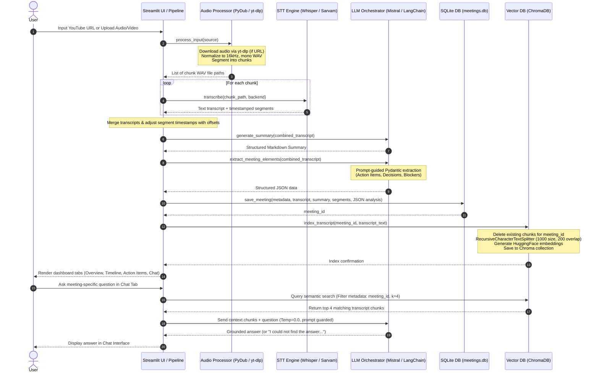

# AI Meeting Assistant & RAG Q&A Engine

An advanced, enterprise-grade meeting intelligence platform that automates transcription, structured summarization, action-item extraction, and context-aware question answering (RAG) for meeting recordings. 

Built with **Python**, **Streamlit**, **Whisper**, **Sarvam AI**, **Mistral AI**, **LangChain**, **ChromaDB**, and **SQLite**.

---

## Table of Contents
1. [System Architecture](#system-architecture)
2. [E2E Pipeline Walkthrough (Part-by-Part)](#e2e-pipeline-walkthrough-part-by-part)
   - [Part 1: Ingestion & Audio Normalization](#part-1-ingestion--audio-normalization)
   - [Part 2: Dual-Backend Transcription Engine](#part-2-dual-backend-transcription-engine)
   - [Part 3: LangChain LCEL Summarization & Pydantic Extraction](#part-3-langchain-lcel-summarization--pydantic-extraction)
   - [Part 4: Dual-Database Persistence Layer](#part-4-dual-database-persistence-layer)
   - [Part 5: Deep-Dive: Context-Filtered RAG Q&A Engine](#part-5-deep-dive-context-filtered-rag-qa-engine)
   - [Part 6: Streamlit UI & Document Export Subsystem](#part-6-streamlit-ui--document-export-subsystem)
3. [Database Schemas](#database-schemas)
   - [SQLite Schema (Relational Storage)](#sqlite-schema-relational-storage)
   - [ChromaDB Schema (Vector Storage)](#chromadb-schema-vector-storage)
4. [Environment Setup & Installation](#environment-setup--installation)
5. [Running the Application](#running-the-application)
6. [Testing the E2E Integration Pipeline](#testing-the-e2e-integration-pipeline)

---

## System Architecture

The following sequence diagram outlines the entire workflow of the platform, from ingesting a recording to generating answers through retrieval-augmented generation (RAG):



---

## E2E Pipeline Walkthrough (Part-by-Part)

### Part 1: Ingestion & Audio Normalization
The ingestion pipeline is designed to accept two types of input sources: a public YouTube video URL or a local media file (supporting `.wav`, `.mp3`, `.m4a`, `.mp4`, `.ogg`, `.flac`).

*   **YouTube Downloader (`utils/audio_processor.py`):** Uses `yt-dlp` to extract the audio stream from the URL (`format: 'bestaudio/best'`) and pipes it through the `FFmpegExtractAudio` post-processor to generate a raw `.wav` file.
*   **Acoustic Standardization:** Audio parameters must be standardized before sending them to transcription models to prevent degradation of Word Error Rates (WER). The pipeline uses `pydub.AudioSegment` to resample the audio:
    *   **Frame Rate:** 16,000 Hz (16kHz sample rate, the standard expected by Whisper and Sarvam AI).
    *   **Channels:** Mono (1 channel, to remove spatial channels and reduce size).
*   **Time-Chop Segmentation (Chunking):** Speech API uploads have file-size limits (e.g., Sarvam AI restricts files to under 30 seconds), and local models can experience memory exhaustion on long files. The pipeline segments the normalized audio using `pydub` slicing:
    *   **Whisper Default:** 600-second (10-minute) chunks.
    *   **Sarvam AI Default:** 25-second chunks.

---

### Part 2: Dual-Backend Transcription Engine
To support localization and multilingual pipelines, the transcriber (`utils/transcriber.py`) supports two runtimes:

1.  **Local OpenAI Whisper:** Runs locally via the `whisper` library. The model is loaded into CPU/GPU memory (`whisper.load_model(model_name)`). It processes the audio stream and outputs a dictionary with raw text and timestamped segments.
2.  **Sarvam AI REST API:** Connects to the Sarvam AI speech-to-text API (`saaras:v3` model) optimized for Indian languages, Hindi, and colloquial Hinglish (code-switching). Since Sarvam requires short chunks, the default audio chunking is set to 25 seconds.
3.  **Linear Timestamp Alignment (Offset Reconstruction):** When transcribing files segment-by-segment, segment timestamps reset to `0.0` at the beginning of each chunk. To reconstruct a cohesive meeting timeline, the system dynamically shifts the timestamps. The start and end time of each segment from chunk $i$ are adjusted using the chunk offset:
    $$\text{Global Timestamp} = \text{Segment Time} + (i \times \text{Chunk Length})$$
    These adjusted segments are compiled into a master list for the interactive timeline.

---

### Part 3: LangChain LCEL Summarization & Pydantic Extraction
Once a unified transcript is obtained, the pipeline utilizes **LangChain Expression Language (LCEL)** and **Mistral AI** to generate summaries and extract key meeting elements:

1.  **Structured Summarization (`utils/summarise.py`):**
    *   Uses a `ChatPromptTemplate` to specify format parameters: Meeting Title, Overview Paragraph, and Key Discussion Points.
    *   Connects to `ChatMistralAI` (default: `open-mistral-7b`) with a moderate temperature of `0.3` for general summarization.
    *   Pipes results through the `StrOutputParser()` to ensure raw markdown text returns.
2.  **Pydantic-Grounded Information Extraction (`utils/extractor.py`):**
    *   To prevent unstructured JSON outputs that break frontends, the extraction schema is declared using Pydantic models:
        *   `ActionItem`: contains `description` (str), `owner` (optional str), and `deadline` (optional str).
        *   `Decision`: contains `description` (str) and `context` (optional str).
        *   `OpenQuestion`: contains `question` (str) and `context` (optional str).
        *   `ExtractedElements`: merges lists of `action_items`, `decisions`, and `open_questions`.
    *   A `JsonOutputParser` configured with the `ExtractedElements` schema generates instructions that are injected into the system prompt.
    *   Mistral AI parses the transcript under a low temperature (`0.1`) to ensure precise extraction, returning a parsed JSON payload matching the Pydantic classes.

---

### Part 4: Dual-Database Persistence Layer
To keep the application responsive, the system divides storage duties:

1.  **SQLite (Relational Metadata & Timelines):**
    *   Stores meeting metadata, raw text, markdown summaries, and serialized JSON payloads (adjusted segments timeline, extracted action items, decisions, and blockers) in `meetings.db`.
    *   This provides fast loading of the historical records sidebar, interactive timeline tabs, and PDF generator feeds.
2.  **Chroma DB (Dense Vector Embeddings):**
    *   Stores vectorized meeting chunks to enable semantic search for the RAG engine.
    *   Maintains a directory-based storage structure (`/chroma_db`) using the vector database library `chromadb`.

---

### Part 5: Deep-Dive: Context-Filtered RAG Q&A Engine
The Retrieval-Augmented Generation (RAG) engine is a core highlight of the project. It allows users to ask natural language questions about any processed meeting.

```
       +---------------------------------------------+
       |             USER CHAT QUESTION              |
       +---------------------------------------------+
                              |
                              v
       +---------------------------------------------+
       |   Vector Store (ChromaDB) Retrieval Query   |
       |  Filters: metadata.meeting_id = current_id  |
       |  Search Metric: Cosine Similarity           |
       |  Top-K: 4                                   |
       +---------------------------------------------+
                              |
                              v
       +---------------------------------------------+
       |     4 Relevance Chunks Formatted Text       |
       |          (Separated by "\n\n---\n\n")       |
       +---------------------------------------------+
                              |
                              v
       +---------------------------------------------+
       |      Prompt Guarding System Template        |
       |  "Answer ONLY based on context"             |
       |  "If not present, return exact error block" |
       +---------------------------------------------+
                              |
                              v
       +---------------------------------------------+
       |      ChatMistralAI Invocation (Temp=0)       |
       +---------------------------------------------+
                              |
                              v
       +---------------------------------------------+
       |     Factual, Hallucination-Free Answer      |
       +---------------------------------------------+
```

#### How the Vector Database is Built & Indexed (`utils/vector_store.py`)
1.  **Idempotent Data Cleaning:** Before indexing, the system checks if the current `meeting_id` has existing vectors in the Chroma collection:
    ```python
    vectorstore._collection.delete(where={"meeting_id": meeting_id})
    ```
    This prevents duplicate entries when a user re-processes or re-uploads a meeting recording.
2.  **Recursive Chunking:** The full transcript is split into overlap chunks using `RecursiveCharacterTextSplitter`.
    *   **Chunk Size:** 1,000 characters.
    *   **Chunk Overlap:** 200 characters (maintains semantic context at chunk boundaries).
3.  **Dense Embedding Generation:** Document chunks are converted into dense vector representations using the `sentence-transformers` model `all-MiniLM-L6-v2` via HuggingFace Embeddings.
    *   **Dimension Size:** 384 dimensions.
    *   **Distance Metric:** Cosine similarity.
4.  **Metadata Association:** Each document segment is stored alongside metadata specifying its parent meeting ID: `{"meeting_id": meeting_id}`.

#### How Question-Answering Runs (`utils/rag_engine.py`)
1.  **Metadata-Filtered Retrieval:** The vector store is converted into a retrieval interface with a strict partition:
    ```python
    retriever = vectorstore.as_retriever(
        search_kwargs={
            "filter": {"meeting_id": meeting_id},
            "k": 4
        }
    )
    ```
    *   **Multi-tenant Security/Partitioning:** By injecting `{"meeting_id": meeting_id}` as a metadata filter, the retriever restricts its search space to document chunks originating from *that specific meeting database entry*. This prevents leakage across separate meetings.
    *   **Top-K Chunks:** It retrieves the top $k = 4$ most relevant chunks.
2.  **Prompt Guarding & Grounding:** The retrieved document segments are concatenated using a separator (`\n\n---\n\n`). They are then formatted into a strict system prompt:
    > "Answer the user's question about the meeting based ONLY on the provided transcript context. Be concise, professional, and truthful. If the provided context does not contain enough information to answer the question, respond with exactly: 'I could not find the answer in the meeting transcript.' Do not make up facts or extrapolate."
3.  **Execution Chain:** The query is routed through a LangChain LCEL pipeline:
    ```python
    rag_chain = (
        {
            "context": retriever | format_docs,
            "question": RunnablePassthrough()
        }
        | prompt
        | llm
        | StrOutputParser()
    )
    ```
    *   **Temperature Calibration:** The LLM client (`ChatMistralAI`) uses a temperature of `0.0` to eliminate creative variance and maximize factual accuracy.

---

### Part 6: Streamlit UI & Document Export Subsystem
1.  **Streamlit Web Application (`app.py`):**
    *   Uses custom CSS to inject styling, override native elements, and load the Google Font `Outfit`.
    *   Custom layouts create a modern, dark-mode-friendly UI featuring glassmorphic sidebar headers, red badges for missing keys, and colored indicators for active backends.
    *   **Tabs Layout:** Offers tabs for the Markdown Summary, structured checklist view of Action Items, Chat QA (grounded in the vector store), interactive timeline segment list, and the raw text file viewer.
2.  **PDF Report Export Engine (`utils/exporter.py`):**
    *   Uses `fpdf2` library to compile metadata, structured summary text, and parsed checklists into a professional layout.
    *   **MeetingReportPDF Class:** A subclass of `FPDF` that handles layout parameters, generates running headers, and adds page numbers ("Page X/Y") via the `footer()` method.
    *   Returns raw binary data (`bytes`) which is delivered to the user through Streamlit's `st.download_button`.

---

## Database Schemas

### SQLite Schema (Relational Storage)
The SQLite file `meetings.db` contains a single database table named `meetings`.

| Column | Data Type | Constraints / Details |
| :--- | :--- | :--- |
| `id` | `INTEGER` | `PRIMARY KEY AUTOINCREMENT` - Row identifier used as foreign lookup keys in Chroma |
| `title` | `TEXT` | `NOT NULL` - The title of the meeting |
| `source` | `TEXT` | `NOT NULL` - Source identifier (YouTube URL or filename) |
| `backend` | `TEXT` | `NOT NULL` - STT engine used (`whisper` or `sarvam`) |
| `duration` | `REAL` | Total duration of the recording in seconds |
| `transcript_text` | `TEXT` | `NOT NULL` - Complete plain text transcript of the recording |
| `summary_markdown`| `TEXT` | Structured Markdown summary generated by Mistral AI |
| `segments_json` | `TEXT` | Serialized JSON string containing an array of segment objects: `[{"start": float, "end": float, "text": str}]` |
| `analysis_json` | `TEXT` | Serialized JSON string of the structured extraction: `{"action_items": [...], "decisions": [...], "open_questions": [...]}` |
| `created_at` | `TIMESTAMP`| `DEFAULT CURRENT_TIMESTAMP` - Date and time of insertion |

---

### ChromaDB Schema (Vector Storage)
Chunks are stored within a persistent collection named `meeting_transcripts` located at `/chroma_db`.

*   **Chroma Embedding Schema:**
    *   `id`: Unique identifier for each chunk.
    *   `document` (`page_content`): A substring segment of the transcript text (max 1000 characters, overlap 200 characters).
    *   `embedding`: 384-dimensional floating-point dense vector generated by `all-MiniLM-L6-v2`.
    *   `metadata`: Dictionary mapping metadata attributes used for filtered retrieval:
        ```json
        {
          "meeting_id": <int_id_matching_sqlite_id>
        }
        ```

---

## Environment Setup & Installation

### 1. Prerequisites
Ensure you have the following installed on your machine:
*   Python 3.10, 3.11, or 3.12 (Pydub/Whisper compatibility is highly stable here).
*   **FFmpeg** (Required by Whisper and Pydub for audio decoding and manipulation).

### 2. Install Project Dependencies
In a terminal, run the following commands to set up the environment and install dependencies:

```bash
# Clone the repository and navigate inside the folder
cd ai-meeting-assistant

# Create a Python virtual environment
python -m venv .venv

# Activate the virtual environment (Windows)
.venv\Scripts\activate

# Install required libraries
pip install -r requirements.txt
```

### 3. Configure API Credentials
Create a `.env` file in the root directory by copying the example:

```bash
cp .env.example .env
```

Open `.env` and configure your API keys:
```env
# Required for LangChain LLM, Summary & Action Item Extraction, and RAG Q&A
MISTRAL_API_KEY=your_mistral_api_key_here

# Required ONLY if using the Sarvam AI STT API backend for Hindi/Hinglish speech
SARVAM_API_KEY=your_sarvam_api_key_here
```

---

## Running the Application

Once your virtual environment is active and keys are configured, launch the Streamlit frontend application:

```bash
streamlit run app.py
```

Open the web interface in your browser (usually hosted at `http://localhost:8501`).

---

## Testing the E2E Integration Pipeline

The project includes an end-to-end integration script (`test_pipeline.py`) that tests the entire workflow—from downloading audio, segmenting and transcribing, generating summaries and actions, saving data, indexing in Chroma, to running a RAG question.

To run the pipeline test:

```bash
# Run using default settings (transcribes "Me at the zoo" via local Whisper 'tiny' model)
python test_pipeline.py

# Customize the target source, transcription backend, and RAG question
python test_pipeline.py --url "https://www.youtube.com/watch?v=YOUR_VIDEO_ID" --backend whisper --whisper-model base --question "What was the main topic discussed?"
```
